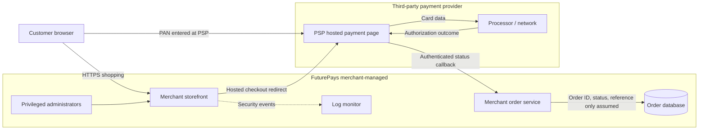

# Proposed FuturePays Payment Flow

**Status: Conceptual architecture only; not deployed or validated.**

Cardholder data is **assumed** to be submitted directly to the PSP-hosted page. FuturePays is assumed to receive reference and order status only. Verify by inspecting source code, web behavior, data stores, logs, backups and PSP contract.

**Scoping caution:** The merchant storefront and redirect logic can impact payment security even without merchant PAN storage; this is not an SAQ eligibility determination.